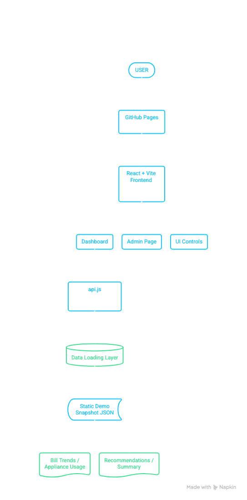

# Watt & Where ⚡

**Understand your energy. Make smarter electricity decisions.**

Watt & Where is a web-based electricity analytics dashboard designed to help users understand their electricity consumption, explore monthly bill trends, analyse appliance-level energy usage, and identify opportunities to reduce electricity costs.

## Features

- **Dashboard Overview:** View electricity usage and key energy insights.
- **Bill Trends:** Compare monthly electricity bills and identify changes over time.
- **Consumption Breakdown:** Explore estimated energy consumption across appliances.
- **Recommendations:** Get actionable suggestions to improve energy efficiency.
- **Summary Reports:** Access a consolidated view of energy usage and insights.
- **Appliance Management:** Manage appliance information through the admin interface.
- **Accessible Interface:** Adjustable text sizes for improved readability.
- **Demo Mode:** Load sample data from a static snapshot for demonstrations without requiring a live backend.
- **Accessibility for Older Residents:** Adjustable text-size controls (A, A+, A++) make the dashboard easier to read for older residents in the apartment community and others who prefer larger text. This helps residents comfortably view electricity usage, bill trends, and recommendations.

## Architecture

The application uses a React frontend built with Vite. Dashboard data is loaded through a dedicated API abstraction, allowing the frontend to work with the configured data source, including a static demo snapshot.



## Technology Stack

- React
- Vite
- JavaScript
- HTML and CSS
- GitHub Pages for static hosting
- GitHub Actions for automated deployment

## Project Structure

```text
Watt_and_Where/
├── .github/
│   └── workflows/
│       └── deploy-pages.yml
├── frontend/
│   ├── public/
│   │   ├── demo-snapshot.json
│   │   └── sample-report.html
│   ├── src/
│   │   ├── components/
│   │   ├── pages/
│   │   ├── api.js
│   │   ├── App.jsx
│   │   └── styles.css
│   ├── package.json
│   └── vite.config.js
└── README.md
```

## Run Locally

Prerequisites: Node.js and npm.

```bash
git clone https://github.com/manya302/Watt_and_Where.git
cd Watt_and_Where/frontend
npm install
npm run dev
```

Open the local URL printed by Vite in your terminal.

## Build for Production

```bash
cd frontend
npm run build
```

The production build is generated in `frontend/dist/`.

## Deployment

The application is configured for GitHub Pages deployment through GitHub Actions.

**Live demo:** https://manya302.github.io/Watt_and_Where/

The deployment workflow builds the frontend and publishes the generated static files to GitHub Pages.

Testing admin password:

Username: admin

Password: wattadmin2026


## Purpose

Watt & Where aims to make electricity consumption easier to understand by presenting usage patterns, bill comparisons, and energy-saving insights in an accessible dashboard.
